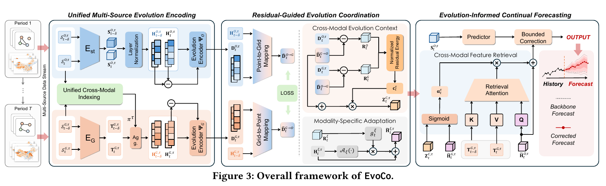

<div align="center">

# EvoCo

**Exploiting Partial Synchrony in Cross-Modal Evolution Coordination for Continual Spatio-Temporal Forecasting**

[](https://www.python.org/)
[](https://pytorch.org/)
[](https://developer.nvidia.com/cuda-toolkit)

A plug-and-play module that coordinates point observations and gridded fields for continual spatio-temporal forecasting.

</div>

---

## Overview

Web of Things systems keep two views of the same process: station readings at discrete locations, and gridded fields over the region. As both streams move forward, their changes are only partly in sync. Most stations move with the surrounding grid, while a few locations deviate.

EvoCo is a plugin for an existing continual forecasting backbone. It builds a shared evolution context from both modalities, uses the mapping residual as a signal of local deviation, and adds a bounded correction to the backbone forecast. The same plugin is attached to EAC, STBP, STRAP, and Storm.

This repository contains the model, trainer, and the configuration files for the reported runs. Processed datasets, preprocessing scripts, checkpoints, and training logs are not included.

## Framework

<div align="center">
  
</div>

| Module | What it does | Where |
| --- | --- | --- |
| Unified Multi-Source Evolution Encoding | Anchors grid cells to stations, then encodes the current state, a lagged state, and their difference | `encode_numeric`, `encode_visual`, `_evolution` in `src/model/coevo_st.py` |
| Residual-Guided Evolution Coordination | Learns mappings in both directions, builds a shared context, and opens a low-rank adapter from the residual | `coordinate` |
| Evolution-Informed Continual Forecasting | Retrieves nearby grid features and adds a bounded correction to the backbone forecast | `extract`, `w_y` |

The training loss in `src/trainer/coevo_trainer.py` is

```text
L = L_pred + λ_O · L_O + λ_map · L_map
```

`L_pred` is the corrected forecast, `L_O` is the backbone forecast (`λ_O = 1`), and `L_map` is the bidirectional mapping loss. The first period trains the backbone and the plugin together. Later periods load the previous checkpoint. EAC and STBP then freeze the shared encoder. STRAP and Storm keep updating all of their parameters.

## Backbones

EvoCo subclasses the backbone and replaces its trunk. The `method` field in each JSON selects the class. `CoEvo_ST` is EAC with the plugin. Config keys named `caqra_*` are the gridded-field loader used by every dataset. CAQRA is only the Air-Stream gridded source.

| Paper | Class | Config | Code |
| --- | --- | --- | --- |
| EAC w/ EvoCo | `CoEvo_ST_Model` | `Co-EAC.json` | `src/model/model.py` |
| STBP w/ EvoCo | `CoEvo_STBP_Model` | `Co-STBP.json` | `src/model/stbp.py` |
| STRAP w/ EvoCo | `CoEvo_STRAP_Model` | `Co-STRAP.json` | `src/model/strap.py` |
| Storm w/ EvoCo | `CoEvo_Storm_Model` | `Co-Storm.json` | `src/model/storm.py` |

## Getting Started

```bash
pip install torch==2.2.1 --index-url https://download.pytorch.org/whl/cu121
pip install -r requirements.txt
```

Train one backbone on one dataset:

```bash
python main.py --conf conf/evoco/PEMS04/Co-EAC.json --gpuid 0 --seed 42
```

Other reported runs use the same entry. Swap the config path:

```text
conf/evoco/PEMS03/Co-STBP.json
conf/evoco/AIR/Co-STRAP.json
conf/evoco/USEAST/Co-Storm.json
conf/evoco/SOILSM/Co-EAC.json
```

`--seed` overrides the seed. Checkpoints and logs are written to the `model_path` in the config (`log/<dataset>/`) when training starts.

Shared plugin settings are feature size 64, evolution size 32, adapter rank 8, temporal offset 3, 4 anchored grid cells, spatial decay 0.05, and EMA momentum 0.99. Learning rate, correction bound `coevo_kappa`, and `coevo_lambda_map` are set in each JSON. EAC uses `coevo_lambda_map = 0.1`. The other three backbones use `0.02`, except STBP on Air-Stream, which uses `0.1`. Every run takes 12 input steps and predicts the next 12 steps.

## Datasets

Put the processed files under `data/` at the paths already written in the JSON files. Each period needs:

- `graph_path/{year}_adj.npz`, array key `x`
- `save_data_path/{year}.npz`, with `train` / `val` / `test` arrays and `*_t_end`
- a station file at `station_meta_pattern`, with `lon` and `lat`, one row per node
- gridded fields at 128×128

PEMS04 period ids `0`–`6` are the seven graph snapshots in chronological order. Traffic grids are stored as `{year}_128_3.npy`.

| Dataset | Target | Periods | Point observations | Gridded field | Config | Processed path |
| --- | --- | --- | --- | --- | --- | --- |
| PEMS03-Stream | Traffic flow, 5 min | 2011–2017 | [TrafficStream](https://github.com/AprLie/TrafficStream) snapshots, Jul 10–Aug 9 | Interpolated from the same station flows | `conf/evoco/PEMS03` | `data/PEMS03/FastData_mm/` |
| PEMS04-Stream | Traffic flow, 5 min | 7 phases | [TEAM](https://github.com/kvmduc/TEAM-topo-evo-traffic-forecasting) evolving graphs, Apr–Oct | Interpolated from the same station flows | `conf/evoco/PEMS04` | `data/PEMS04/FastData_mm/` |
| Air-Stream | AQI, 1 hour | 2018–2022 | [China air-quality history](https://quotsoft.net/air/) | [CAQRA reanalysis](https://doi.org/10.11922/sciencedb.00053) | `conf/evoco/AIR` | `data/AIR/FastData_hourly_compare_mm/` |
| USEAST-Stream | 2 m temperature, 3 hours | 2018–2022 | [NOAA ISD-Lite](https://www.ncei.noaa.gov/pub/data/noaa/isd-lite/) | [ERA5-Land](https://open-meteo.com/en/docs/historical-weather-api) 2 m temperature | `conf/evoco/USEAST` | `data/USEAST/FastData_rand622/` |
| SOILSM-Stream | 5 cm soil moisture, 3 hours | 2018–2022 | [NOAA USCRN](https://www.ncei.noaa.gov/pub/data/uscrn/products/) | [ERA5-Land](https://open-meteo.com/en/docs/historical-weather-api) 0–7 cm soil water | `conf/evoco/SOILSM` | `data/SOILSM/FastData/` |

Gridded tensors for PEMS03, PEMS04, USEAST, and SOILSM go in `heatmap_cache_dir` as `{year}_128_3.npy`. Air-Stream reads hourly CAQRA frames from `data/caqra_aqi_images_hourly/`.

| Dataset | Graph | Stations | Gridded field directory |
| --- | --- | --- | --- |
| PEMS03-Stream | `data/PEMS03/graph/` | `data/PEMS03/meta/stations_{year}.csv` | `data/PEMS03/heatmap_cache/` |
| PEMS04-Stream | `data/PEMS04/graph/` | `data/PEMS04/meta/stations_{year}.csv` | `data/PEMS04/heatmap_cache/` |
| Air-Stream | `data/AIR/graph/` | `data/AIR/retained_stations/retained_stations_{year}_AQI_aqi.csv` | `data/caqra_aqi_images_hourly/` |
| USEAST-Stream | `data/USEAST/graph/` | `data/USEAST/retained_stations/retained_stations_{year}_T2m.csv` | `data/USEAST/vis_nwp/` |
| SOILSM-Stream | `data/SOILSM/graph/` | `data/SOILSM/retained_stations/retained_stations_{year}_SM.csv` | `data/SOILSM/vis_era5sm/` |

## Repository

```text
Submitted-EvoCo/
├── main.py                  # training and evaluation
├── requirements.txt
├── assets/framework.png     # Figure 3
├── conf/evoco/              # one JSON per dataset and backbone
├── src/model/coevo_st.py    # EvoCo plugin
├── src/model/coevo_*.py     # EAC, STBP, STRAP, Storm wrappers
├── src/trainer/             # EvoCo loop and data loaders
├── src/dataer/              # point and gridded samples
└── utils/                   # anchors, frames, metrics
```

## Acknowledgements

Backbone code is adapted from [EAC](https://openreview.net/forum?id=FRzCIlkM7I), STBP, [STRAP](https://arxiv.org/abs/2505.19547), and Storm. Traffic snapshots come from [TrafficStream](https://github.com/AprLie/TrafficStream) and [TEAM](https://github.com/kvmduc/TEAM-topo-evo-traffic-forecasting).
